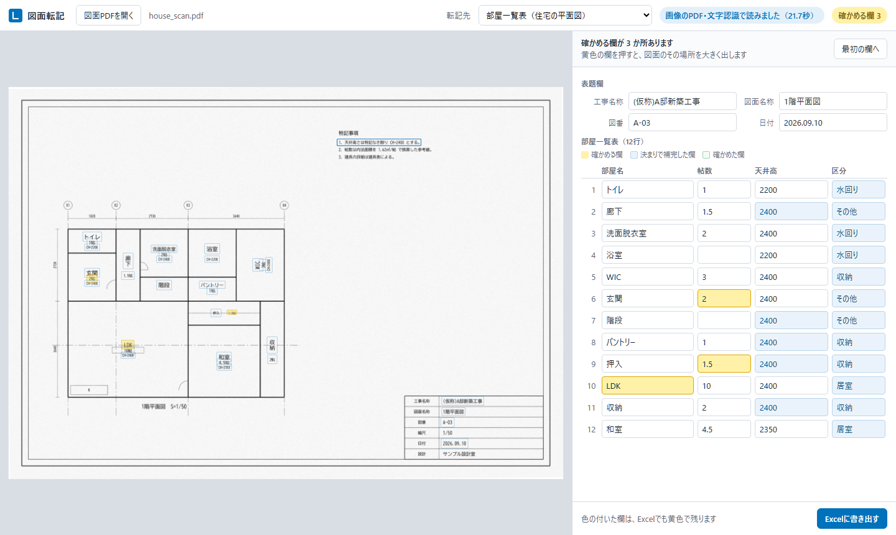

# drawing-pdf-to-excel

[](https://github.com/Mxhlix/drawing-pdf-to-excel/actions/workflows/test.yml)

English | [日本語](#日本語)

A tool that reads title block and table values from drawing PDFs, lets you check them on screen, and then writes them to an Excel list.
Values it is not confident about are highlighted, so a person can compare them with the drawing and correct them.



## What it does

- Reads page 1 of a drawing PDF and automatically tells apart three kinds:
  PDFs with real text, PDFs where the text has been turned into lines (vector shapes), and image-only PDFs such as scans.
- For PDFs with real text, it extracts the text directly from the PDF. The other two kinds are rendered as images and read with PaddleOCR (the lightweight PP-OCRv5 model).
- It assigns the text it read to fields according to per-form settings (`config/*.yaml`).
  There are three ways: "the value to the right of a label" in the title block, values near room names on a floor plan, and rows of tables in the drawing.
- It picks which form a drawing belongs to automatically, based on words in the drawing. You can change the choice on screen.
- Clicking a yellow field on screen shows a zoomed view of that spot on the drawing. Corrected values can be written straight to Excel.
- Fields that have not been confirmed stay yellow in Excel too, with the reason written in a cell note.

The DXF files are only output alongside by the script that generates the sample drawings. This tool does not read DXF.

## Design notes

- Errors are never inserted silently. A field is highlighted when recognition confidence is below 0.90, when a drawing number or date does not match the expected format, when a room name was mapped to a close word from the list, or when an equipment schedule quantity differs from the number of symbols on the drawing.
- A person checks at the end. Instead of generating Excel automatically and stopping there, the flow has you compare highlighted fields with the drawing before writing out.
- Form changes do not need code changes. Field positions and alternative labels are in `config/*.yaml`, and the lists of room names and categories are in `設定.xlsx`. Staff can add to them in Excel.
- Drawings do not leave the machine. Everything, including OCR, runs on the PC. The server listens on `127.0.0.1` only.
- Values shown on screen are escaped. HTML in text read from a drawing will not run.
- Only the written files are served. The download API returns only files inside `output/`.

## Accuracy

15 sample drawings made for this repository (5 kinds × 3 PDF types) were read and each field was compared against the ground truth (`samples/*_truth.json`) (2026-10-04).
Conditions: Windows 11, Core i9-12900K (CPU only), Python 3.10.9, paddlepaddle 3.3.1, paddleocr 3.7.0.

| PDF type | Fields | Correct | Highlighted (value correct) | Highlighted (value wrong) | Wrong, not highlighted | Missed |
|---|---|---|---|---|---|---|
| Real text | 196 | 196 | 0 | 0 | 0 | 0 |
| Text as lines | 196 | 187 | 3 | 1 | 0 | 5 |
| Image | 196 | 169 | 18 | 4 | 0 | 5 |

- Fields filled with a wrong value without highlighting: 0 in all 15 drawings.
- The 5 missed fields are one row for 「廊下」 (corridor) in the lighting drawing. In both the text-as-lines PDF and the image PDF, the room name could not be read and the row went missing. The rest of that row's values (fixture symbol, quantity, circuit, power consumption) appear on screen as a highlighted row with only the room name blank.
- Automatic form detection was correct for all 15 drawings.
- Time per drawing was under 1 second for PDFs with real text, and 14.5 to 38.5 seconds for the 10 drawings that use OCR.

The sample drawings were made for this repository, so accuracy on real drawings has not been measured.

## Getting started

Checked with Python 3.10.

```
python -m venv .venv
.venv\Scripts\activate            # Windows. On macOS / Linux: source .venv/bin/activate
pip install -r requirements-dev.txt
pytest                            # automated tests for real-text PDFs, type detection and the API (27 tests, a few seconds)
```

To also read text-as-lines and image PDFs, install PaddleOCR. The first run downloads the OCR models.

```
pip install -r requirements-ocr.txt
pytest -m ocr -s                  # tests for the 10 drawings that use OCR (15 to 40 seconds each)
python evaluate.py                # print results for all 15 drawings and write results/eval.json
python app.py                     # open http://127.0.0.1:8961
```

On screen, press 「図面PDFを開く」 (Open drawing PDF) and choose a PDF in `samples/` to try it. Exported Excel files go to `output/`.

GitHub Actions runs only `pytest`, which does not use OCR.

## Project layout

```
app.py              UI and API (FastAPI)
static/index.html   UI
zumen/reader.py     PDF type detection and extraction of text with positions (including OCR)
zumen/mapper.py     assigns text to form fields and decides why a field is highlighted
zumen/excel_out.py  writes into the Excel form
config/*.yaml       per-form settings (5)
templates/          target Excel forms (5)
設定.xlsx            lists of room names, equipment names and finish materials
samples/            sample drawings and ground truth
make_templates.py   generates the forms and 設定.xlsx
evaluate.py         compares the 15 sample drawings with the ground truth
tests/              automated tests
docs/               screenshots
```

## Not yet verified

- Not tried with drawings and Excel forms used in real business.
- Only page 1 of a PDF is read. Multi-page drawings are not handled.
- OCR time and accuracy were measured only on the CPU of the PC above.
- The sample drawings are fictional and were made with a separate script that is not included in this repository. Only the resulting PDFs and their ground truth (`samples/`) are included.
- GitHub Actions uses Python 3.10 only. Other versions have not been tried.

## License

MIT. See [LICENSE](LICENSE).

---

## 日本語

図面PDFから表題欄や表の値を読み取り、画面で確かめてから Excel の一覧表に書き出すツールです。
自信の無い値には色を付け、担当者が図面と見比べて直せるようにしています。


### できること

- 図面PDFの1ページ目を読み、次の3つの形を自動で見分けます。
  文字が文字のまま入ったPDF、文字が線（図形）に変わったPDF、スキャンなどの画像だけのPDF。
- 文字入りのPDFは、PDFの中の文字をそのまま取り出します。残りの2つは画像にして PaddleOCR（PP-OCRv5 の軽い版）で読みます。
- 読んだ文字を、様式ごとの設定（`config/*.yaml`）に従って欄に振り分けます。
  表題欄の「項目名の右隣の値」、平面図の部屋名の近くにある値、図面の中の表の行、の3通りです。
- どの様式の図面かは、図面の中の言葉から自動で選びます。画面で選び直せます。
- 画面で黄色の欄を押すと、図面のその場所を拡大して見せます。直した値はそのまま Excel に書き出せます。
- 確かめが済んでいない欄は、Excel でも黄色のまま残し、理由をメモに書きます。

DXF ファイルは、見本の図面を作るスクリプトが一緒に出力しているだけです。このツールは DXF を読みません。

### 設計で気をつけたこと

- **間違いを黙って入れない。** 読み取りの確かさが 0.90 未満のとき、図番や日付が決まった形に合わないとき、部屋名を一覧の近い言葉に読み替えたとき、機器表の台数と図面上の記号の数が違うときに、欄に色を付けます。
- **最後は人が確かめる。** 自動で Excel を作って終わりにせず、色の付いた欄を図面と見比べてから書き出す流れにしています。
- **様式が変わってもコードを変えない。** 欄の位置や項目名の言い換えは `config/*.yaml` に、部屋名の一覧や区分は `設定.xlsx` に置きました。担当者が Excel で書き足せます。
- **図面を外に出さない。** 文字認識も含めて PC の中だけで動きます。サーバは `127.0.0.1` だけで待ち受けます。
- **画面に出す値はエスケープする。** 図面から読んだ文字に HTML が入っていても実行されません。
- **書き出したファイル以外は渡さない。** ダウンロードの API は `output/` の中のファイルしか返しません。

### 精度

このリポジトリ用に作った見本図面15枚（5種類 × 3つの形）を読み、正解（`samples/*_truth.json`）と欄ごとに突き合わせました（2026-10-04）。
条件は Windows 11、Core i9-12900K（CPU のみ）、Python 3.10.9、paddlepaddle 3.3.1、paddleocr 3.7.0 です。

| PDFの形 | 欄の数 | 正しく入った | 色付き（値は正しい） | 色付き（値が違う） | 色なしで違う | 拾えなかった |
|---|---|---|---|---|---|---|
| 文字入り | 196 | 196 | 0 | 0 | 0 | 0 |
| 文字が線 | 196 | 187 | 3 | 1 | 0 | 5 |
| 画像 | 196 | 169 | 18 | 4 | 0 | 5 |

- 色を付けずに違う値を入れた欄は、15枚とも0でした。
- 拾えなかった5欄は、照明の設備図の「廊下」の1行です。文字が線のPDFと画像のPDFの両方で、部屋名が読めずに行が欠けました。その行の残りの値（器具記号・台数・回路・消費電力）は、部屋名の欄だけが空欄で色付きの行として画面に出ます。
- 様式の自動判定は15枚とも合っていました。
- 1枚にかかった時間は、文字入りのPDFが1秒未満、文字認識を使う10枚が14.5〜38.5秒でした。

見本の図面はこのリポジトリ用に作ったものなので、実際の図面での精度は測っていません。

### 動かし方

Python 3.10 で確かめています。

```
python -m venv .venv
.venv\Scripts\activate            # Windows。macOS / Linux は source .venv/bin/activate
pip install -r requirements-dev.txt
pytest                            # 文字入りPDF・形の判定・API の自動テスト（27項目、数秒）
```

文字が線のPDFと画像のPDFも読むときは、PaddleOCR を入れます。初回は文字認識のモデルをダウンロードします。

```
pip install -r requirements-ocr.txt
pytest -m ocr -s                  # 文字認識を使う10枚のテスト（1枚15〜40秒）
python evaluate.py                # 15枚の結果を画面と results/eval.json に出す
python app.py                     # http://127.0.0.1:8961 を開く
```

画面で「図面PDFを開く」を押し、`samples/` の中のPDFを選ぶと試せます。書き出した Excel は `output/` に入ります。

GitHub Actions では、文字認識を使わない `pytest` だけを動かしています。

### フォルダ構成

```
app.py              画面と API（FastAPI）
static/index.html   画面
zumen/reader.py     PDFの形の判定と、文字と位置の取り出し（文字認識を含む）
zumen/mapper.py     読んだ文字を様式の欄に振り分け、色を付ける理由を決める
zumen/excel_out.py  様式の Excel に書き込む
config/*.yaml       様式ごとの設定（5つ）
templates/          転記先の Excel の様式（5つ）
設定.xlsx            部屋名・機器名・仕上材の一覧
samples/            見本の図面と正解
make_templates.py   様式と 設定.xlsx を作る
evaluate.py         見本の図面15枚を正解と突き合わせる
tests/              自動テスト
docs/               画面写真
```

### まだ確かめていないこと

- 実際の業務で使われている図面と Excel の様式では試していません。
- 読むのは PDF の1ページ目だけです。複数ページの図面は扱っていません。
- 文字認識の時間と精度は、上の PC の CPU でしか測っていません。
- 見本の図面は架空のもので、別のスクリプトで作りました。作るスクリプトはこのリポジトリに含めていません。含めているのは、できあがった PDF と正解のファイル（`samples/`）だけです。
- GitHub Actions は Python 3.10 だけです。ほかの版では試していません。

### ライセンス

MIT です。[LICENSE](LICENSE) を見てください。
